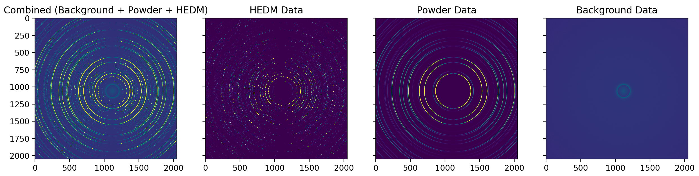

# PowHEDM_simulator
 Simulation engine to generate 2D area detector frames with powder and HEDM data



- **Multi-material simulation**: Supports simulation of multiple crystalline materials simultaneously
- **Hybrid data generation**: Combines HEDM (single crystal spots) and powder diffraction (continuous rings) patterns
- **Forward simulation with MIDAS**: Simulates real diffraction patterns using [MIDAS](https://github.com/marinerhemant/MIDAS) forward simulation for actual grain orientations
- **Realistic backgrounds**: Includes Thomson scattering, Compton scattering, Poisson noise, and Gaussian noise
- **Materials Project integration**: Automatically retrieves crystal structure data via Materials Project API
- **Configurable parameters**: Extensive configuration options for experimental conditions
- **Multiple output formats**: Supports HDF5 and compressed NPZ file formats

<hr />

<ins> **Contents**</ins> :
- dir: PowHEDM_sim: Contains the classes for simulating powder, HEDM and background data
- file: PowHEDM_sim/midas_fwsim.py: Contains the class for running the [MIDAS](https://github.com/marinerhemant/MIDAS) forward simulation
- file: PowHEDM_sim/mpxrd_sim.py: Contains the class for running the materials project XRD simulation
- file: PowHEDM_sim/bkg_sim.py: Contains the class for running the background simulation
- file: PowHEDM_sim/run_powHEDM_sim.py: Main execultion script to run the simulation engine
- file: PowHEDM_sim/create_mpxrd_cache.py: Creates materials project xrd simulation cache
- file: default_config.json: Contains the default configuration for the simulation engine
- dir: in_grain_files: Contains the grain orientations file for the simulation. It can be downloaded from [https://anl.box.com/s/3s600lzbj0hfoxmdfw1ha671rk9cw4ro]
- dir: mpxrd_cache: Contains the xrd simulations from Materials project. Each material has an hkl file and an info file associated with it.

<hr />

<ins> **Prerequisites**</ins> :

Before using this script, ensure you have the following dependencies installed:
- MIDAS installation: Github link to MIDAS [https://github.com/marinerhemant/MIDAS]
- Python 3.12 or higher
- NumPy
- Pandas
- h5py
- zarr
- pymatgen
- mp_api

<ins> **NOTE** </ins> :
- A 'default_config.json' file is provided in the root directory. Simulation engine used this by default. For your simulations, modify this file or create a copy of this file (Recommended) with the desired parameters.
- The [MIDAS](https://github.com/marinerhemant/MIDAS) installation path is hardcoded in the configuration file. Please change the path to the correct path for your system.
- Make sure you have a valid Materials Project API key. Go to [https://next-gen.materialsproject.org/api] and create an account to get the API key. This will be needed to generate XRD simulation if the material data is not already available in mpxrd_cache.

<hr />

Run the powHEDM_sim/run_powHEDM_sim.py script to run the simulation engine.

```bash
python PowHEDM_sim/run_powHEDM_sim.py \
    -projName <project_name> \
    -mp_apikey <materials_project_api_key> \
    -nr_frames <number_of_frames>
```

To generate the materials project cache, run the powHEDM_sim/create_mpxrd_cache.py
```bash
python PowHEDM_sim/create_mpxrd_cache.py \
    -mp_apikey <materials_project_api_key> \
```


## Command Line Arguments

### Required Arguments

| Argument | Type | Description |
|----------|------|-------------|
| `-projName` | `str` | Project name (used as output directory name). This directory will be created in the current working directory. |
| `-mp_apikey` | `str` | Materials Project API key for crystal structure data |
| `-nr_frames` | `int` | Number of diffraction frames to generate |

### Optional Arguments

| Argument | Type | Default | Description |
|----------|------|---------|-------------|
| `-configFile` | `str` | `"default_config.json"` | Path to configuration file |
| `-grainFile` | `str` | `"in_grain_files/n1000000-id1.tess.orientations.csv"` | Path to grain orientations file |
| `-mpxrdCacheDir` | `str` | `"mpxrd_cache"` | Directory that contains the materials project cache |
| `-clearZarrDump` | `str` | `"yes"` | Clear zarr dump directory after simulation (`"yes"`/`"no"`) |
| `-clearPSDump` | `str` | `"no"` | Clear parameter dump directory after simulation (`"yes"`/`"no"`) |
| `-clearGrainDump` | `str` | `"yes"` | Clear grain dump directory after simulation (`"yes"`/`"no"`) |
| `-saveHdf5` | `str` | `"no"` | Save output as HDF5 file (`"yes"`/`"no"`) |
| `-saveNpz` | `str` | `"yes"` | Save output as compressed NPZ file (`"yes"`/`"no"`) |

<hr />

## Configuration File

The configuration file is a JSON file that contains the configuration for the simulation engine. It is used to specify the experimental conditions for the simulation.

A default configuration file is provided in the root directory as "default_config.json".


<hr />

## Output
If the `-saveHdf5` argument is set to `"yes"`, the output will be saved in the project directory as "powHEDM_frames.h5" file.
It has three keys: "HEDM", "Powder", "Background".
Loading the hdf5 file and accessing the data is straightforward using h5py.

```python
import h5py
import os

proj_dir = "path-to-proj-dir"
frame_idx = 1 #frame number to be loaded

frame_h5_path = os.path.join(proj_dir, "frame_dump", f"frame_{frame_idx}.h5")
h5data = h5py.File(frame_h5_path)
hedm_data = f["HEDM"]
powder_data = f["Powder"]
background_data = f["Background"]
```

If the `-saveNpz` argument is set to `"yes"`, the output will be saved in the project directory as "powHEDM_frames.npz" file.
It has three keys: "HEDM", "Powder", "Background".
Loading the npz file and accessing the data is straightforward using numpy.

```python
import numpy as np
import os

proj_dir = "path-to-proj-dir"
frame_idx = 1 #frame number to be loaded

frame_npz_path = os.path.join(proj_dir, "frame_dump", f"frame_{frame_idx}.npz")
data = np.load(frame_npz_path)
hedm_data = data["HEDM"]
powder_data = data["Powder"]
background_data = data["Background"]
```
